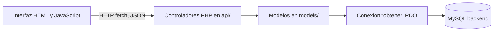

# API REST de RUNAWAY

Todos los endpoints devuelven JSON UTF-8. Los cambios de productos y estados de compra requieren una sesión con rol `admin`. Los datos de clientes se filtran en el servidor: una cuenta cliente solo puede consultar sus propias compras.

## Arquitectura y trazabilidad



Los controladores validan el método, los datos y los permisos, y asignan el código HTTP. Los modelos concentran consultas PDO preparadas. La conexión se comparte mediante `Conexion::obtener()`.

| Caso o dato de AE1/AE2 | Persistencia | Endpoint asociado |
|---|---|---|
| CU02: consultar el catálogo | `productos` | `GET /api/productos.php` |
| CU03: consultar la ficha | `productos` | `GET /api/productos.php?id=...` |
| CU06: completar y registrar la compra | `compras`, `compra_detalles`, `productos` | `GET /api/tarifas.php`, `POST /api/compras.php` |
| CU07: revisar y consultar una compra | `compras`, `compra_detalles` | `GET /api/compras.php`, `GET /api/compras.php?id=...` |
| AE2: precio y cupón UCP10 | `productos`, `cupones` | `GET /api/tarifas.php` |
| AE2: inventario y alertas | `productos.stock`, `productos.umbral_critico` | Lectura por `GET /api/productos.php`; los cambios de stock se aplican al registrar, cancelar o eliminar compras. |
| Sesiones y cuentas existentes | `usuarios` | `api/login.php`, `api/registro.php`, `api/perfil.php`, `api/logout.php` |

## Productos

| Método | URL | Acceso | Resultado |
|---|---|---|---|
| GET | `/api/productos.php` | Público | Lista productos activos. Acepta `q` y `categoria` como filtros opcionales. |
| GET | `/api/productos.php?id=1` | Público | Devuelve el detalle de un producto activo. |
| POST | `/api/productos.php` | Administrador | Crea un producto y responde `201 Created`. |
| PUT | `/api/productos.php?id=1` | Administrador | Reemplaza los datos editables del producto. |
| DELETE | `/api/productos.php?id=1` | Administrador | Desactiva el producto para conservar referencias históricas. |

El cuerpo de POST y PUT usa estos campos: `ref`, `nombre`, `subtitulo`, `categoria`, `especificacion`, `talles`, `precio`, `imagen`, `stock` y `umbralCritico`. `talles` puede ser una lista o una cadena separada por comas.

Ejemplo de respuesta de listado:

```json
{
  "estado": "exito",
  "data": [
    {
      "id": 1,
      "ref": "001",
      "nombre": "Nocturne Hoodie",
      "subtitulo": "Heavyweight / Black",
      "categoria": "Hoodies",
      "especificacion": "Algodón premium · calce oversized",
      "talles": "S,M,L,XL",
      "precio": "245000.00",
      "imagen": "assets/campaign-batman.jpg",
      "stock": 3,
      "umbralCritico": 5
    }
  ]
}
```

## Tarifas y promociones

| Método | URL | Acceso | Resultado |
|---|---|---|---|
| GET | `/api/tarifas.php?ref=001` | Público | Devuelve el precio del producto, los productos disponibles y los cupones vigentes. |
| GET | `/api/tarifas.php?producto_id=1` | Público | Devuelve las mismas tarifas para el producto indicado. |

La respuesta conserva las claves `producto` y `descuentos` utilizadas por el calculador de AE2. El precio y la vigencia del cupón se vuelven a consultar en MySQL al crear la compra; el total enviado por el navegador nunca se toma como autoridad.

## Compras

| Método | URL | Acceso | Resultado |
|---|---|---|---|
| POST | `/api/compras.php` | Público | Registra un pedido, calcula precios en el servidor y descuenta stock dentro de una transacción. Responde `201 Created`. |
| GET | `/api/compras.php` | Sesión | Lista las compras de la cuenta; `admin` ve todas. |
| GET | `/api/compras.php?id=12` | Sesión | Devuelve una compra propia o cualquier compra si la sesión tiene rol `admin`. |
| PUT | `/api/compras.php?id=12` | Administrador | Actualiza el estado a `pendiente`, `confirmada` o `cancelada`. Al cancelar restituye el stock. |
| DELETE | `/api/compras.php?id=12` | Sesión | Elimina únicamente compras pendientes propias; un administrador puede eliminar cualquier compra pendiente. Restituye el stock. |

El cuerpo de POST tiene esta forma:

```json
{
  "cliente": {
    "nombre": "Nombre y apellido",
    "direccion": "Dirección de entrega",
    "telefono": "3764000000",
    "email": "cliente@example.com",
    "medio_pago": "tarjeta_credito"
  },
  "items": [
    { "producto_id": 1, "talle": "M", "cantidad": 1 }
  ],
  "codigo_cupon": "UCP10"
}
```

`medio_pago` acepta `tarjeta_credito`, `tarjeta_debito`, `transferencia` o `mercado_pago`. El proyecto registra el medio elegido y el pedido; no realiza cobros. La cuenta de usuario se asocia automáticamente cuando existe una sesión. El checkout de AE1 sigue disponible como compra de invitado.

## Códigos HTTP

| Código | Uso |
|---|---|
| 200 | Consulta o actualización exitosa. |
| 201 | Producto o compra creados. |
| 400 | JSON inválido, campos faltantes o valores inválidos. |
| 401 | Se requiere una sesión para consultar compras o ejecutar una acción protegida. |
| 403 | La sesión no tiene rol administrador para una operación administrativa. |
| 404 | Producto o compra inexistente o fuera del alcance de la cuenta. |
| 405 | Método HTTP no permitido; se incluye la cabecera `Allow`. |
| 409 | Referencia duplicada, stock insuficiente o estado incompatible con la operación. |
| 500 | Error interno. El detalle PDO se guarda en el log del servidor y no se envía al cliente. |
